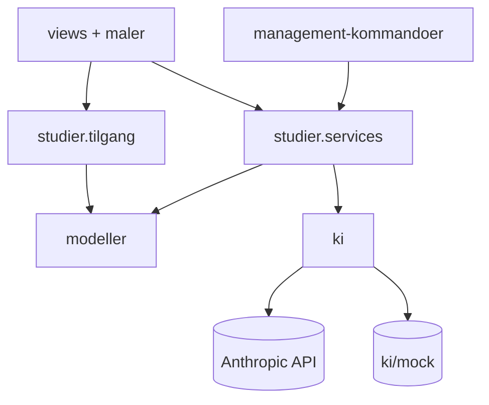
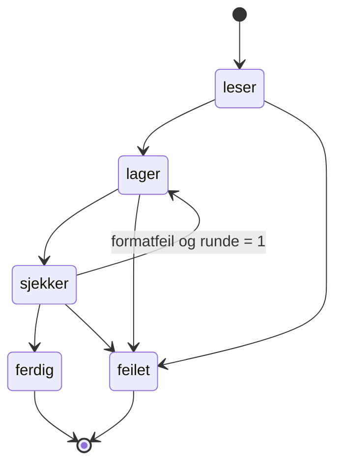
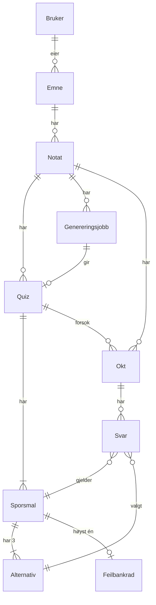
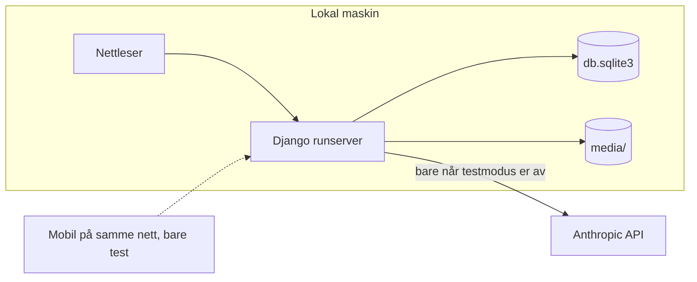

# Arkitektur-spine – FåreQuiz v1

## Designparadigme

Lagdelt Django-monolitt med tjenestelag. Avhengigheter går bare nedover. `ki` importerer aldri fra `studier` eller `kontoer`.

| Lag | Hvor | Ansvar |
| --- | --- | --- |
| Views og maler | `kontoer/views.py`, `studier/views.py`, `templates/` | HTTP, skjemaer, HTMX-fragmenter. Ingen domeneregler. |
| Tjenester | `studier/services/` | Domeneregler og alle skrivinger listet i AD-1. |
| Tilgang | `studier/tilgang.py` | Eierfiltrering (AD-8). |
| Modeller | `kontoer/models.py`, `studier/models.py` | Data og constraints. |
| KI-adapter | `ki/` | Fil → sjekket quizutkast. Kjenner ikke databasen. |



## Invarianter og regler

### AD-1 – Domeneskrivinger bor i tjenestelaget

- **Binds:** FR-6–FR-8, FR-12–FR-23, FR-28
- **Prevents:** At views, skjemaer og seed hver får sin egen versjon av reglene.
- **Rule:** Bare funksjoner i `studier/services/` oppretter, endrer eller sletter `Notat` (via `last_opp`), `Quiz`, `Okt`, `Svar`, `Feilbankrad`, `Genereringsjobb`, filer på disk og `Bruker.vilkar_godtatt`. Views og management-kommandoer kaller tjenestene. Bare `Emne` (opprette, gi nytt navn) kan lagres rett fra et skjema. Skjemaet får `eier` i konstruktøren og sjekker selv at navnet er unikt hos eieren, uten å skille mellom store og små bokstaver.

### AD-2 – Én funksjon registrerer et svar mot feilbanken

- **Binds:** FR-19, FR-21, FR-22, FR-23
- **Prevents:** Ulik telling av «to riktige på rad» og ulik telling av hva som skjedde i en økt.
- **Rule:** `registrer_svar(sporsmal, riktig) -> Hendelse` er eneste vei til `Feilbankrad`. `Hendelse` ∈ {`lagt_i`, `nullstilt`, `opp`, `laert`, `ingen`}.
  - Feil svar: oppretter raden med `get_or_create` (`lagt_i`), eller åpner en lært rad på nytt og nullstiller telleren (`nullstilt`).
  - Riktig svar på et spørsmål i feilbanken: telleren øker med 1 (`opp`). Ved 2 settes `laert_tidspunkt` (`laert`).
  - Ellers: `ingen`.

  Kalles bare fra `lever_okt` (AD-18). Hendelsen lagres på `Svar.hendelse`. Resultatsidene leser hendelsene og regner dem aldri ut på nytt.

### AD-3 – Feilbankrader slettes aldri, de merkes som lært

- **Binds:** FR-21, FR-23, FR-24
- **Prevents:** At én utvikler sletter rader ved «lært» mens en annen trenger dem til fasit og dekningsgrad.
- **Rule:** Høyst én `Feilbankrad` per `Sporsmal` (unik). «I feilbanken» betyr `laert_tidspunkt IS NULL`. Rader forsvinner bare når emnet slettes (AD-14).

### AD-4 – Dekningsgrad regnes ut, lagres aldri

- **Binds:** FR-24, FR-25
- **Prevents:** En lagret verdi som blir utdatert, og ulike definisjoner av «dekket».
- **Rule:** `services.dekningsgrad` er eneste implementasjon.
  - Et spørsmål er **dekket** når det har minst ett riktig `Svar` i en levert `Okt` (begge typer) og ingen åpen `Feilbankrad`.
  - **Notat:** vektet etter FR-24.
  - **Emne:** snittet av notatene som har minst én quiz. Har ingen notater quiz, vises ingen dekningsgrad.

  Regnes som et tall mellom 0 og 1 uten avrunding, og avrundes til hele prosent bare i malen.

### AD-5 – Spørsmål har identitet per quiz

- **Binds:** FR-16, FR-21, FR-24
- **Prevents:** At spørsmål med lik tekst slås sammen, og at feilbank og dekningsgrad får ulik nevner.
- **Rule:** Et `Sporsmal` hører til én `Quiz` og identifiseres bare av sin ID. Lik tekst i to quizer er to spørsmål.

### AD-6 – Forsøk og øvingsøkt er én modell, `Okt`

- **Binds:** FR-17, FR-18, FR-20, FR-22, FR-26
- **Prevents:** To leveringsløp, og to veier til eieren.
- **Rule:**
  - **Felter:** `type` ∈ {`forsok`, `oving`}, `status` ∈ {`pabegynt`, `levert`}, `opprettet`, `sist_endret`, `levert_tidspunkt`, `poengsum` og `antall` (satt ved levering).
  - **Notat og quiz:** `Okt.notat` er alltid satt. `Okt.quiz` er satt hvis og bare hvis `type=forsok` (`CheckConstraint`).
  - **Påbegynte økter:** Det finnes høyst én påbegynt `forsok` per quiz og høyst én påbegynt `oving` per notat (betinget `UniqueConstraint`). Økten startes med POST via `start_eller_fortsett_okt`, som henter den påbegynte økten hvis den finnes.
  - **Historikk:** `type=forsok`, `status=levert`, sortert på `levert_tidspunkt`. «Fortsett der du slapp» viser påbegynte økter sortert på `sist_endret`.

### AD-7 – Svar peker på alternativ-ID, aldri på posisjon

- **Binds:** FR-17, FR-18, FR-22
- **Prevents:** Feil svar etter stokking.
- **Rule:**
  - **Fasit:** `Alternativ.er_riktig`, med nøyaktig ett riktig alternativ per spørsmål (sikres når quizen lagres).
  - **Svar:** `Svar` har `okt`, `sporsmal`, `alternativ` og `hendelse`, med `UniqueConstraint(okt, sporsmal)`.
  - **Posisjon:** Posisjonen (`nr`, 1-basert) brukes bare til navigering og slås opp via `Okt.innhold` (AD-16). Svar lagres eller sammenlignes aldri via posisjon eller bokstav.

### AD-8 – Alle ID-er fra forespørselen går gjennom eierhjelperen

- **Binds:** FR-3, NFR-2
- **Prevents:** Et IDOR-hull fra én glemt eiersjekk.
- **Rule:**
  - **Hjelpere:** `studier/tilgang.py` har `hent_egen(modell, pk, bruker)` og `egne(modell, bruker)`. Begge gir `Http404` for andres data.
  - **Veien til eieren:** står bare her: `notat__emne__eier` for `Okt`, `okt__notat__emne__eier` for `Svar`, og tilsvarende for de andre modellene.
  - **Alle ID-er:** ID-er fra URL, GET og POST løses med hjelperne, eller valideres mot et objekt som allerede er hentet med dem. Querysets i skjemaer bygges med `egne`. Et rått oppslag på pk i views er forbudt.
  - **Innlogging:** håndheves med `LoginRequiredMiddleware`. Bare innlogging og registrering har `@login_not_required`.
  - **Originalfiler:** serveres aldri over HTTP. Det finnes ingen URL-rute til `MEDIA_ROOT`.

### AD-9 – Generering er en stegvis HTMX-kjede med en jobbrad

- **Binds:** FR-12–FR-15
- **Prevents:** Doble KI-kall ved ny innlasting av siden, to quizer fra én jobb, og jobber som henger.
- **Rule:**
  - **Jobben:** `Genereringsjobb` har `notat`, `vanskelighetsgrad`, `antall`, `startet`, `status`, `runde` (1 eller 2), `i_gang`, `feilkode`, `raatt_svar`, `forhandslagret`, `modell` og `prompt_versjon`.
  - **Aktiv jobb:** `services.generering.aktiv_jobb(notat)` er eneste definisjon. Den gjelder status som ikke er `ferdig` eller `feilet`. En jobb som har stått i over 120 s, settes til `feilet`/`timeout` når den leses.
  - **Opprettelse:** «Lag quiz» og «Prøv igjen» oppretter en ny jobb bare hvis det ikke finnes en aktiv jobb.
  - **Ett steg om gangen:** Hvert kall på `/jobber/<id>/steg/` tar jobben med `filter(pk, status=S, i_gang=False).update(i_gang=True)`. Endres 0 rader, returneres bare gjeldende fragment, som spør igjen.
  - **Stegene:** `leser` validerer filen. `lager` leser filen på nytt og kaller `generer`. `sjekker` kjører `sjekk` og lagrer quizen. Filinnholdet lagres aldri på jobben eller i sesjonen.
  - **Én quiz per jobb:** `Quiz.jobb` er en `OneToOneField`.
  - **Når notatet er borte:** Mangler jobben eller notatet, returneres et sluttfragment, ikke 404.



### AD-10 – Faste feilkoder for generering

- **Binds:** FR-13, FR-15
- **Prevents:** At hver utvikler finner opp egne feiltilstander og meldinger.
- **Rule:** `feilkode` ∈ {`timeout`, `format`, `for_lite_innhold`, `for_stor`, `api_nokkel`, `api_feil`}. `ki` hever bare `KIFeil(kode)`. En fil som mangler, blir `api_feil`. Tekstene til brukeren står i `farequiz/feilmeldinger.py`. En feilet jobb lagrer ingen quiz.

### AD-11 – KI-adapteren og kontrakten mot den [ADOPTED]

- **Binds:** FR-9, FR-12, FR-13, FR-27, FR-29, NFR-3, NFR-5, NFR-6, NFR-7
- **Prevents:** At den som lager mock-filene, den som skriver `sjekk` og den som lagrer quizen, lager hver sin form.
- **Rule:**
  - **Funksjonene i `ki`:**
    - `les_fil(sti) -> Innhold(sha256, type, data)`. PDF sendes hel. DOCX og TXT gir uttrukket tekst, med UTF-8 og cp1252 som reserve.
    - `generer(innhold, vanskelighetsgrad, antall, timeout) -> RaattSvar(tekst, forhandslagret, modell, prompt_versjon)`
    - `sjekk(raatt, antall) -> QuizUtkast`
  - **`QuizUtkast`:** `sprak` (BCP 47), `modell`, `prompt_versjon`, `forhandslagret` og `sporsmal: [{tekst, begrunnelse, alternativer: [{tekst, er_riktig}] × 3}]`.
  - **Kallet til modellen:** `generer` bruker structured outputs (`output_config.format`) med det samme skjemaet og setter `effort` eksplisitt.
  - **Sjekken:** `sjekk` håndhever FR-13 og at feltene finnes, også for mock-svar.
  - **Lagring:** `Quiz` lagrer `sprak`, `modell`, `prompt_versjon` og `forhandslagret` fra utkastet. Hvert `Sporsmal` lagrer `begrunnelse`.
  - **Visning:** Malene viser modellen med `ki.visningsnavn(quiz.modell)` og bruker aldri gjeldende innstilling.
  - **Versjon:** `PROMPT_VERSJON` økes ved hver endring av prompt eller skjema.

### AD-12 – Bare `ki` vet om testmodus

- **Binds:** FR-27, FR-28, NFR-3
- **Prevents:** Testmodus-sjekker spredt i koden, og ekte API-kall fra tester og seed.
- **Rule:**
  - **Kilde:** `ki.er_testmodus()` er eneste kilde. Den er sann når `TESTMODUS` er `1`, `true`, `yes` eller `on`, eller når API-nøkkelen mangler. `ki.tving_testmodus()` slår testmodus på for tester og seed.
  - **Mock-svar:** I testmodus slår `generer` opp `innhold.sha256` i `ki/mock/manifest.json` (`{sha256: dokument}` og `standard`). Den returnerer de første N spørsmålene fra `ki/mock/<dokument>/<vanskelighetsgrad>.json`, med `modell` og `prompt_versjon` fra filens metadata. En ukjent fil gir standarddokumentet med `forhandslagret=True`.
  - **Lage mock-svarene:** `manage.py lag_mocksvar` kjører testdokumentene mot ekte modell med 30 spørsmål per nivå og skriver mock-filene og manifestet.
  - **Malene:** En context processor gir malene flagget til testmodus-stripen.

### AD-13 – Svar lagres med vanlige skjemaer, HTMX bare som forbedring

- **Binds:** FR-17, FR-18, NFR-8
- **Prevents:** At deler av quizflyten krever JS mens andre ikke gjør det.
- **Rule:** Neste, Forrige og Lever er POST-skjemaer mot `/okter/<id>/sporsmal/<nr>/` og `/okter/<id>/lever/`, og de virker uten JavaScript. HTMX kan legges på, men skal treffe de samme endepunktene, og en mislykket lagring viser feilmeldingen ved knappen. Bare genereringskjeden (AD-9) krever JavaScript.

### AD-14 – Sletting skjer bare via emnet

- **Binds:** FR-6, FR-8, NFR-3
- **Prevents:** Filer som blir liggende igjen på disken, filer som forsvinner mens notatet står igjen, og sletting av enkeltdeler.
- **Rule:**
  - **Rekkefølge:** `slett_emne(emne)` samler filstiene og sletter emnet med cascade i `transaction.atomic`. Filene slettes i `transaction.on_commit`, og filer som mangler, ignoreres.
  - **Bare her:** Ingen andre steder sletter `Notat`, `Quiz`, `Okt` eller `Feilbankrad`.
  - **Filfeltene på `Notat`:** `fil` (`FileField`, `notater/<eier-id>/<uuid4><endelse>`), `originalnavn`, `filtype` ∈ {`pdf`, `docx`, `txt`} og `storrelse`.

### AD-15 – Egen brukermodell fra første migrering

- **Binds:** FR-1, FR-2, FR-7
- **Prevents:** At én utvikler bruker Djangos `User` med en profilmodell mens en annen lager en egen brukermodell.
- **Rule:**
  - **Modellen:** `kontoer.Bruker` arver `AbstractUser`, med `username = None`, `email` som unik `USERNAME_FIELD`, `REQUIRED_FIELDS = []` og `vilkar_godtatt` (tidspunkt, kan være tomt).
  - **Manager:** `BrukerManager` har `create_user(email, password)`. E-post lagres alltid med små bokstaver.
  - **Oppsett:** `AUTH_USER_MODEL = "kontoer.Bruker"` settes før første `migrate`.

### AD-16 – Innholdet i en økt låses når den opprettes

- **Binds:** FR-17, FR-18, FR-22, FR-23
- **Prevents:** At en øvingsøkt endrer seg når feilbanken endres i en annen fane, og at alternativene stokkes på nytt når brukeren kommer tilbake.
- **Rule:**
  - **Format:** `Okt.innhold` er en `JSONField` med formatet `[{"sporsmal": <id>, "alternativer": [<id>, <id>, <id>]}, …]` i visningsrekkefølge, og listen endres aldri.
  - **Forsøk:** inneholder quizens spørsmål i quizens rekkefølge.
  - **Øvingsøkt:** inneholder spørsmålene med åpen `Feilbankrad` når økten opprettes, sortert på når raden ble opprettet.
  - **Stokking:** Alternativene stokkes for begge typer.
  - **Bruk:** Visning, telling av hva som mangler, levering og resultat bruker bare listen.
  - **Fortsett-lenken:** peker på det første spørsmålet uten svar.
  - **Knappen «Øv på feil»:** En påbegynt øvingsøkt kan fortsettes selv om feilbanken er blitt tom. Knappen er bare låst når feilbanken er tom og det ikke finnes noen påbegynt øvingsøkt.

### AD-17 – `lagre_svar` er eneste måte å skrive et svar på

- **Binds:** FR-17, FR-18, FR-19
- **Prevents:** Doble svar som teller dobbelt, endringer i leverte økter, og alternativer fra feil spørsmål.
- **Rule:** `services.okter.lagre_svar(okt, sporsmal, alternativ)` avviser svaret hvis økten ikke er påbegynt, hvis spørsmålet ikke står i `okt.innhold`, eller hvis alternativet ikke hører til spørsmålet. Ellers kjører den `update_or_create` på (`okt`, `sporsmal`) og oppdaterer `sist_endret`. En levert økt endres aldri, og forsøk på det sender brukeren til resultatsiden.

### AD-18 – Levering er en betinget statusovergang

- **Binds:** FR-17, FR-19, FR-21, FR-23
- **Prevents:** Dobbel levering ved dobbeltklikk eller to faner.
- **Rule:** `lever_okt(okt)` kjører i én `transaction.atomic`. Første skriving er `Okt.objects.filter(pk, status="pabegynt").update(status="levert", levert_tidspunkt=now())`. Endres 0 rader, gjør funksjonen ingenting mer. Deretter, i samme transaksjon: sjekk av at alle spørsmål er besvart (ruller tilbake hvis ikke), `registrer_svar` for hvert spørsmål i `okt.innhold`, og lagring av `poengsum`, `antall` og `Svar.hendelse`.

### AD-19 – Ingen eksterne kall inne i en databasetransaksjon

- **Binds:** FR-12–FR-15, FR-18
- **Prevents:** At SQLite holder skrivelåsen i opptil 120 s, slik at resten av appen får «database is locked».
- **Rule:** `ATOMIC_REQUESTS` er av. Ingen funksjon kaller `ki` mens en transaksjon er åpen. Statusoverganger i genereringen committes før og etter KI-kallet, hver for seg. SQLite kjører med `OPTIONS = {"transaction_mode": "IMMEDIATE", "timeout": 20}`.

### AD-20 – Fasiten er skjult til spørsmålet er lært

- **Binds:** FR-19, FR-22, FR-23
- **Prevents:** At fasiten lekker via malen, for eksempel som en klasse, et dataattributt eller rekkefølgen.
- **Rule:** `er_riktig` og `begrunnelse` sendes aldri til malene for Quiz og Øv på feil. Resultatsidene viser fasit og begrunnelse bare for svar med `hendelse=laert`, eller når `fasit_synlig(sporsmal)` er sann (`laert_tidspunkt` er satt). Rettingen skjer i tjenestelaget.

### AD-21 – Seed lager testdata gjennom de vanlige tjenestene

- **Binds:** FR-27, FR-28, FR-30
- **Prevents:** Testdata med en annen form enn ekte data, og seed som kaller det ekte API-et.
- **Rule:** `manage.py seed_testdata` kjører i `ki.tving_testmodus()` og bruker bare tjenester: `last_opp` med filer fra `testdokumenter/`, `generering.generer_synkront`, som kjører de samme stegfunksjonene etter hverandre, og `lagre_svar` og `lever_okt` med faste svar. Resultatet er quizer, leverte forsøk, en feilbank og ett påbegynt forsøk. Kommandoen kan kjøres flere ganger: finnes testbrukeren, slettes emnene hens med `slett_emne` før de lages på nytt.

### AD-22 – En ny klone kjører uten `.env`

- **Binds:** FR-27, FR-29, FR-30, NFR-4
- **Prevents:** At sensor møter en app som ikke starter, eller ulike oppstartssteg i README og kode.
- **Rule:**
  - **Standardverdier:** Uten `.env` gjelder `DEBUG=True`, en fast utviklingsnøkkel for `SECRET_KEY` merket usikker, `ALLOWED_HOSTS=localhost,127.0.0.1` og testmodus på.
  - **Oppstart:** README og koden bruker nøyaktig disse stegene: `uv sync` (eller `pip install -r requirements.txt`), `python manage.py migrate`, `python manage.py seed_testdata`, `python manage.py runserver`.
  - **Mobiltest:** `ALLOWED_HOSTS` kan utvides i `.env` for testing fra mobil på samme nett. Dette er ikke hosting.

## Konsistenskonvensjoner

| Område | Konvensjon |
| --- | --- |
| Navn i kode | Norske identifikatorer uten æ, ø og å (`Sporsmal`, `Okt`, `Feilbankrad`, `vilkar_godtatt`). Ord fra PRD-ens ordliste brukes med samme betydning. |
| Navn i grensesnitt | Norsk med æ, ø og å, ordene fra ordlisten, tone etter EXPERIENCE.md. |
| Faste verdier | `vanskelighetsgrad` ∈ {`lett`, `middels`, `vanskelig`}. Andre faste verdier er definert i AD-ene. Alle lagres som `TextChoices`. |
| URL-er | `/emner/<id>/`, `/notater/<id>/`, `/quizer/<id>/`, `/okter/<id>/sporsmal/<nr>/`, `/okter/<id>/lever/`, `/okter/<id>/resultat/`, `/jobber/<id>/steg/`. Heltalls-pk. |
| Tid og språk | Lagres i UTC (`USE_TZ=True`) og vises i `Europe/Oslo`. Sidens `lang="nb"`. Spørsmål og alternativer får `lang="{{ quiz.sprak }}"` når språket ikke er norsk. |
| Brukerendringer | Skjema → tjeneste → redirect (POST/redirect/GET). HTMX-svar er fragmenter i `templates/<app>/_<navn>.html`. CSRF-token sendes i `hx-headers` på `<body>`. |
| Feilmeldinger | Tekster i `farequiz/feilmeldinger.py`. Plassering og roller etter EXPERIENCE.md. |
| Konfigurasjon | `settings.py` leser `.env`: `ANTHROPIC_API_KEY`, `KI_MODELL` (standard `claude-sonnet-5-5`), `TESTMODUS`, `SECRET_KEY`, `DEBUG`, `ALLOWED_HOSTS`. `.env.example` holdes oppdatert. |
| Logging | Djangos standard logging til konsollen. Feilede jobber logges med jobb-ID og feilkode, aldri med filinnhold. |
| Migreringer | Alle modeller i AD-6, AD-7, AD-9, AD-14 og AD-15 lages i første story. Migreringer committes. Ved konflikt lages din egen migrering som ikke er merget, på nytt etter rebase. |
| Tester | `manage.py test` med testmodus tvunget på. Regneeksemplene i FR-24 og FR-25 er testtilfeller. En test sjekker at quizsiden ikke skiller ut det riktige alternativet (AD-20). |
| CSS og JS | Tailwind v4: `static/src/app.css` (`@theme` med tokens fra DESIGN.md) bygges med `tailwindcss -i static/src/app.css -o static/css/app.css --minify`, og resultatet committes. htmx ligger som `static/js/htmx.min.js`, aldri via CDN. |
| Avhengigheter | `uv add`, og `uv export --no-hashes -o requirements.txt` ved hver endring. |
| CI og kodestil | `.github/workflows/test.yml` kjører `ruff check`, `ruff format --check` og `manage.py test` (testmodus, uten nøkkel) på hver pull request mot `main`. Rød CI merges ikke. Lages i første story. |

## Stack

| Navn | Versjon |
| --- | --- |
| Python | 3.14 |
| Django | ≥ 5.2.19, < 6.0 |
| anthropic (Python-SDK) | ≥ 2.8, < 3 |
| Claude-modell | `claude-sonnet-5-5` |
| python-docx | 1.2.0 |
| python-dotenv | 1.2.4 |
| htmx | 2.0.11 |
| Tailwind CSS (frittstående CLI) | 4.3.x |
| SQLite | følger med Python |
| uv | ≥ 0.13 |

## Strukturfrø

```text
G82-bull-knold-skjerven/
  manage.py
  pyproject.toml, uv.lock, requirements.txt
  .env.example, .gitattributes      # testdokumenter/** binary, ki/mock/** -text
  farequiz/            # settings, urls, feilmeldinger.py
  kontoer/             # Bruker, BrukerManager, innlogging, registrering
  studier/
    models.py          # Emne, Notat, Quiz, Sporsmal, Alternativ, Okt, Svar, Feilbankrad, Genereringsjobb
    services/          # notater, generering, okter, feilbank, dekningsgrad, emner
    tilgang.py
    management/commands/seed_testdata.py
  ki/
    __init__.py        # les_fil, generer, sjekk, er_testmodus, tving_testmodus, visningsnavn, PROMPT_VERSJON
    management/commands/lag_mocksvar.py
    mock/manifest.json, mock/<dokument>/<vanskelighetsgrad>.json
  testdokumenter/
  templates/
  static/src/app.css, static/css/app.css, static/js/htmx.min.js
  media/               # i .gitignore
  db.sqlite3           # i .gitignore
```





## Kapabilitet → arkitektur

| Område | Ligger i | Styres av |
| --- | --- | --- |
| Konto og innlogging (FR-1, FR-2) | `kontoer` | AD-8, AD-15 |
| Bare egne data (FR-3) | `studier/tilgang.py` | AD-8 |
| Emner (FR-4–FR-6) | `studier`, `services/emner` | AD-1, AD-14 |
| Vilkår og opplasting (FR-7, FR-8) | `services/notater` | AD-1, AD-14, AD-15 |
| Lese fil og generere (FR-9, FR-11–FR-16) | `services/generering`, `ki` | AD-9, AD-10, AD-11, AD-19 |
| Ta quiz (FR-17–FR-20) | `services/okter` | AD-6, AD-7, AD-13, AD-16–AD-18, AD-20 |
| Feilbank og Øv på feil (FR-21–FR-23) | `services/feilbank`, `services/okter` | AD-2, AD-3, AD-5, AD-16, AD-20 |
| Progresjon (FR-24–FR-26) | `services/dekningsgrad` | AD-4, AD-5, AD-6 |
| Testmodus og testbruker (FR-27, FR-28) | `ki`, `seed_testdata`, `lag_mocksvar` | AD-12, AD-21 |
| Konfigurasjon og README (FR-29, FR-30) | `settings.py`, `.env.example`, README | AD-22 |
| KI-merking og sporbarhet (NFR-7, NFR-9) | `Quiz.modell`, `Quiz.prompt_versjon`, maler | AD-11 |
| Språk (NFR-6, WCAG 3.1.2) | `Quiz.sprak`, maler | AD-11, konvensjoner |

## Utsatt

- **Hosting:** v1 kjøres bare lokalt (NFR-4).
- **Bakgrunnsjobber og strømming:** Ikke i v1. AD-9 kan byttes ut uten å endre `ki`.
- **Prompttekst:** Eies av `ki`. Feltene i skjemaet er låst i AD-11.
- **PDF mot tekst, og Sonnet mot Haiku:** v1 sender PDF hel med Sonnet. Viser testfasen noe annet, endres bare `ki.les_fil` eller `KI_MODELL`, og `PROMPT_VERSJON` økes.
- **Verdien av `effort` og faktisk genereringstid:** Måles i testfasen mot fristen på 120 s.
- **Generering uten JavaScript:** Ikke krevd. Tas opp hvis WCAG-testen viser behov.
- **Melde spørsmål som feil (faglærer 4.1):** PRD-endring, sendt til gruppa.
